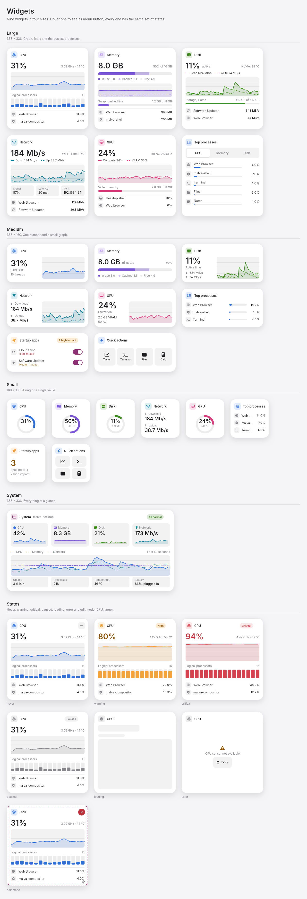
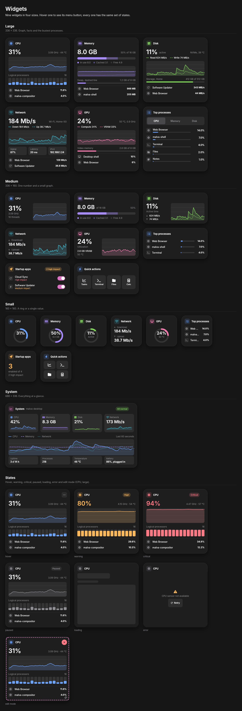

# malva-widgets

The widget system UI kit for Malva OS, written in [Slint](https://slint.dev) 1.18. Frontend only: no backend,
no Rust/C++/JS glue. All sample data is inline, so the kit runs as it is.

The look is the Malva look: neutral grey surfaces, charcoal and silver text, Inter, and the logo's plum as the only accent.




```
slint-viewer ui/app.slint                 # the gallery: sidebar, light/dark switch, live graphs
slint-viewer --load-data tools/dark.json ui/app.slint     # start in dark mode
python3 tools/shoot.py                    # render every page to screenshots/ (light and dark)
```

Get `slint-viewer` from https://github.com/slint-ui/slint/releases (or `cargo install slint-viewer`).
To use the kit in your own app, copy `ui/` into your project and import what you need, for example
`import { CpuWidget } from "ui/widgets/resources.slint";`. Every component sizes itself from its properties.

## The look

All colours come from the `Theme` global in `ui/theme.slint`, and its values are the Malva UI kit's
(`tokens/malva-tokens.json` in [Malva-ui-toolkit](https://github.com/Malvaos/Malva-ui-toolkit)):

| | Light | Dark |
|---|---|---|
| Page | `#F5F5F7` | `#161617` |
| Card | `#FFFFFF` | `#1E1E1F` |
| Text | `#1D1D1F` | `#F5F5F7` |
| Secondary text (`muted`) | `#86868B` | `#8E8E93` |
| Accent (primary buttons, switches, selection, focus) | `#8C3274` | `#DC73C2` |
| Label on the accent (`on-primary`) | `#FFFFFF` | `#1D1D1F` |

Radii are 6 / 10 / 14 / 22 px, durations 90 / 160 / 240 / 380 ms, and shadows are black. Roles the kit does not define (`sub`, `para`,
the translucent overlays) are neutral derivations, never tinted toward the brand.

* **Resource colours are data colours, not brand colours.** CPU and Processes are the kit's info blue, Disk is its success green, Memory
  is violet, Network teal, GPU pink and Startup apps amber, so the nine widgets can be told apart. The accent is not used for them.
* **Status colours** (`ok`, `warn`, `danger`, `info`) are the kit's, with the `*-text` variants for text.
* **Contrast**, measured from the tokens on the card colour: text 16.8 : 1 light and 15.3 : 1 dark, `sub` 10.0 and 10.9, `para` 7.9 and 9.9,
  `muted` 3.6 and 5.1 (supporting text only), accent 7.4 and 5.8, label on the accent 7.4 and 5.8, status text 5.5 or more.

## What is inside

| Page in the gallery | File | Components |
| --- | --- | --- |
| Widgets | `ui/pages/widgets_page.slint` | CPU, Memory, Disk, Network, GPU, Processes, Startup, Quick actions, System. Sizes S 160×160, M 336×160, L 336×336, XL 688×336. States: normal, warning, critical, paused, loading, error, hover, edit |
| Controls | `ui/pages/controls_page.slint` | Buttons (6 kinds), checkbox, radio, switch, slider, text field, tabs, segmented control, chips, badges, progress, ring, skeleton, step dots |
| Dialogs | `ui/pages/dialogs_page.slint` | 12 stock dialogs, administrator permission dialog in 7 states |
| More dialogs | `ui/pages/dialogs_page.slint` | Progress ×6, forms ×5, lists ×4, About, crash report |

Library files:

```
ui/theme.slint          Theme (colors, radii, durations, easings, light/dark) and Brand (product names)
ui/base.slint           Icon, Txt, Surface/Elevation, DashedBorder, FocusRing, Pill, IconTile, Bar, Spinner, Kbd
ui/icons.slint          110 Font Awesome Free solid icons as paths (regenerate with tools/gen_icons.py)
ui/controls.slint       Btn, CheckBox, RadioDot, Toggle, ToggleRow, Slide
ui/fields.slint         Field, TabBar, Segmented, Chip, StatusBadge, Count, Progress, Ring, Skeleton, StepDots
ui/mock.slint           Sample data for the graphs (regenerate with tools/gen_mock.py)
ui/widgets/             WidgetFrame and the nine widgets
ui/dialogs.slint        DialogCard and the twelve stock dialogs
ui/dialogs_auth.slint   RootAuthDialog (confirm, password, wrong, fingerprint, checking, locked, success)
ui/dialogs_more.slint   ProgressDialog, FormDialog, ListDialog, AboutDialog, CrashDialog
ui/fonts/               Inter (4 weights) and JetBrains Mono, with their licences
ui/assets/              the Malva mark (malva-mark.svg), shown in the gallery sidebar
```

## Light and dark

Everything reads its colors from the `Theme` global. Set `Theme.dark` to flip the whole UI, for
example `in-out property <bool> dark <=> Theme.dark;` on your window (the gallery does this with its switch).
Because `Theme` is a global, light and dark cannot be shown side by side in one window.

## Product names

Every product string lives in the `Brand` global at the top of `ui/theme.slint` (`os`, `product`, `host`, `shell`, `compositor`,
`version`), so changing one is a one-line edit. They are "Malva", "Malva Widgets", `malva-desktop`, `malva-shell` and `malva-compositor`.

## Relation to the Malva UI kit

This repository carries its own copy of the controls (`Btn`, `Toggle`, `Field`, `Tabs`, dialogs and so on) and its own `Theme`, so it
runs without the kit. The values match the kit's, but they are copied, not imported: if a token changes in the kit, change it in
`ui/theme.slint` too. The icons are Font Awesome Free paths (110 of them), not the kit's SVG set. Rebuilding the nine widgets on the
kit's own components (`from "@malva/malva.slint"`) would remove both duplicates; it has not been done.

## Slint limits you may notice

- No backdrop blur: "glass" surfaces are drawn as flat translucent fills.
- No dashed borders or strokes: `DashedBorder` draws them from many small rectangles.
- No `text-transform` and no `line-height`, so some paragraphs are a little tighter than in the design boards.
- Sample data is static, except the graphs, which step through eight frames once a second.

## Licences

- Inter: SIL Open Font License 1.1 (`ui/fonts/Inter-LICENSE.txt`)
- JetBrains Mono: SIL Open Font License 1.1 (`ui/fonts/JetBrainsMono-OFL.txt`)
- Icons: Font Awesome Free solid, CC BY 4.0 (https://fontawesome.com/license/free)
- The kit itself: use it freely in your own projects. There is no `LICENSE` file yet; add one before relying on the repository elsewhere.
